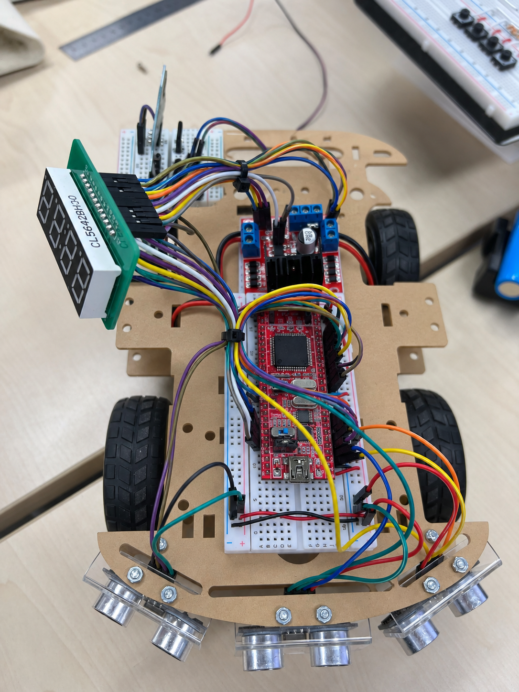

# Auto Car

ATmega128A와 초음파 센서를 이용한 자율주행 자동차 펌웨어입니다. 전방 장애물까지의 거리에 따라 주행 방향을 제어하고, 블루투스 명령으로 수동 운전할 수 있습니다.

## 차량 사진

## 주요 기능

- 자동 주행: 전방 거리가 20cm보다 크면 전진하고, 20cm 이하면 좌회전합니다.
- 초음파 거리 측정: 좌측, 전방, 우측 센서를 순차적으로 측정하고 UART0으로 출력합니다. 현재 주행 판단에는 전방 거리만 사용합니다.
- 수동 주행: UART1으로 수신한 블루투스 명령으로 전진, 후진, 좌회전, 우회전, 정지를 제어합니다.
- 모드 전환: 버튼 0을 눌러 수동 및 자동 모드를 전환합니다. 시작 모드는 수동입니다.
- Timer1 PWM으로 좌우 DC 모터 속도를 제어합니다.

## 하드웨어 연결

| 기능 | ATmega128A 핀 |
| --- | --- |
| 초음파 TRIG (좌 / 전 / 우) | PA0 / PA1 / PA2 |
| 초음파 ECHO (좌 / 전 / 우) | PE4 / PE5 / PE6 |
| 모터 PWM (좌 / 우) | PB5 (OC1A) / PB6 (OC1B) |
| 모터 방향 (좌 / 우) | PF0, PF1 / PF2, PF3 |
| 모드 전환 버튼 | PA4 |

프로젝트는 16MHz 클록을 기준으로 작성되었습니다. 모터 드라이버와 센서의 전원 및 배선은 사용 중인 하드웨어에 맞게 확인하세요.

## 수동 제어 명령

UART1은 9600bps로 설정되어 있으며 대소문자를 모두 사용할 수 있습니다.

| 명령 | 동작 |
| --- | --- |
| `F` | 전진 |
| `B` | 후진 |
| `L` | 좌회전 |
| `R` | 우회전 |
| `S` | 정지 |

## 빌드

AVR GCC와 ATmega128A 디바이스 지원이 필요합니다. Microchip Studio(또는 Atmel Studio)에서 ATmega128A용 C 프로젝트를 만들고 `src/`의 소스와 `include/`의 헤더를 추가한 뒤, 컴파일러의 헤더 검색 경로에 `include/`를 지정하고 빌드합니다. 생성된 HEX 파일을 프로그래머로 보드에 기록합니다. Studio 프로젝트 파일은 Git에서 제외합니다.

## 파일 구성

- `src/main.c`: 초기화, 운전 모드 및 주행 판단
- `src/ultrasonic.c`, `include/ultrasonic.h`: 초음파 센서 측정
- `src/pwm.c`, `include/pwm.h`: 모터 PWM 및 방향 제어
- `src/uart0.c`, `src/uart1.c`: 직렬 통신
- `src/button.c`, `src/led.c`: 버튼 및 LED 제어
